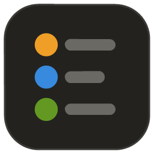

# Claude Session Monitoring Overlay

A small, always-on-top overlay for Windows that shows what your Claude sessions are doing:

- **Needs input**: sessions waiting for you (a permission prompt or a question)
- **Running**: sessions in progress, marked *executing* or *planning*
- **Done**: sessions that finished and that you haven't opened yet

It sits on a second monitor and stays out of your way. Clicks pass straight through it, so you can keep working underneath. Hold **Ctrl** when you want to use it.



## Requirements

- Windows 10 or 11
- The Claude desktop app (Code tab sessions). Claude Code in a terminal is optional, see [Hooks](#hooks).

Nothing is sent over the network. The overlay only reads files on your computer.

## Install

> **Upgrading from Claude Overlay 1.0.x?** Run `install.ps1` from the new zip. It removes the old copy and its Start menu shortcut, and moves your hook and "Start with Windows" setting to the new app. Your settings are kept.

1. Download `ClaudeSessionMonitoringOverlay-1.1.0-win-x64.zip` from the [latest release](../../releases/latest).
2. Right-click the zip, choose **Extract All**, and open the extracted folder.
3. Right-click `install.ps1` and choose **Run with PowerShell**.
   Or, from a PowerShell window in that folder:

   ```powershell
   powershell -ExecutionPolicy Bypass -File .\install.ps1
   ```

The installer copies the app to `%LOCALAPPDATA%\ClaudeSessionMonitoringOverlay\app`, adds a **Claude Session Monitoring Overlay** Start menu shortcut, and starts it. It doesn't need administrator rights.

> **Windows SmartScreen warning:** the app isn't code-signed yet, so Windows may show "Windows protected your PC" the first time. Click **More info → Run anyway**. You can check the file yourself: it's built from the source in this repository.

### Turn on live status (recommended)

Open Settings (Ctrl+click the gear on the overlay, or double-click the tray icon) and turn on **Claude Desktop hook**. This lets the overlay show *Needs input* and exact *Running* / *Done* states. Without it, Running and Done are estimated from the app's files, and *Needs input* can't be detected.

The hook adds a few entries to `~/.claude/settings.json` and saves a backup first. Turning it off removes them again.

### Uninstall

Run `uninstall.ps1` from the extracted folder (or from the source folder):

```powershell
powershell -ExecutionPolicy Bypass -File .\uninstall.ps1
```

This stops the overlay, removes the hook entries, and deletes the app and its shortcut. Add `-RemoveData` to also delete your settings.

## Using it

| Action | How |
|---|---|
| Normal use | Clicks pass through the overlay. It never takes focus. |
| Interact | Hold **Ctrl**. A blue outline appears and the overlay becomes clickable. |
| Move | Ctrl + drag the top bar |
| Opacity | Ctrl + **1–5** while the mouse is over the overlay (20–100%), or the Overall opacity slider |
| Opacity while holding Ctrl | Settings → *Opacity while holding Ctrl* |
| Layer transparency | Settings → Background, Rows/tiles/badges, Text and icons |
| Open a session | Ctrl + click its row. Claude opens that session and comes to the front. |
| Settings | Ctrl + click the gear, or double-click the tray icon |
| Quit / reset position | Right-click the tray icon |
| Start with Windows | Settings → *Start with Windows* |

A Done session drops off the overlay once you open it, either from the overlay or in Claude itself.

Sounds: a chime when a session finishes and a knock when one needs you. Both can be changed in Settings, including to your own WAV or MP3 files.

## Hooks

There are two switches under **Hooks** in Settings. They share one set of entries in `~/.claude/settings.json`, which stay installed while either switch is on.

- **Claude Desktop hook**: live status for sessions in the desktop app.
- **Claude Code hook**: also shows sessions you run with `claude` in a terminal. They're marked **CLI**. Terminal sessions can't be opened in the desktop app, so clicking one just clears it once it's done.

Tool events run in the background (`async`), so the hook doesn't slow Claude down. Each hook call takes about 0.2 seconds.

Hook entries point at the copy of `ClaudeSessionMonitoringOverlay.exe` that was installed. If you move the app, turn the hook off and on again in Settings.

## Troubleshooting

- **Overlay not visible:** right-click the tray icon → *Reset position*. If you use a second monitor that was unplugged, this moves it back to your main screen.
- **Overlay is too faint:** Ctrl+1–5, or the opacity sliders in Settings. Background opacity can't go below 1%, so Ctrl mode can still grab the window.
- **Needs input never shows:** check that *Claude Desktop hook* says Installed in Settings. The hook takes effect from a session's next turn, so sessions already running may need one more message.
- **Log file:** `%LOCALAPPDATA%\ClaudeOverlay\overlay.log`

## How it works

- **Desktop app session files** (`%APPDATA%\Claude\claude-code-sessions\…\local_*.json`, read-only): titles, archived state, plan mode, and when you last opened each session. These are the app's internal files, so an app update could change them.
- **Hook status files** (`%LOCALAPPDATA%\ClaudeOverlay\state\*.json`): written by the hook on prompt submit, tool use, permission request, notification, and stop.

## Build from source

Requires the [.NET 9 SDK](https://dotnet.microsoft.com/download) on Windows.

```powershell
dotnet publish -c Release -o dist
```

This produces a single self-contained `dist\ClaudeSessionMonitoringOverlay.exe`. Run `install.ps1` with that file next to it to install it.

To regenerate the icon, run `tools\make-icon.ps1`.

## Project layout

| File | What it does |
|---|---|
| `Program.cs` | Entry point, single-instance check, startup |
| `SessionMonitor.cs` | Merges desktop session files and hook status into Needs input / Running / Done |
| `Hooks.cs` | Hook mode (`--hook`) and the `~/.claude/settings.json` installer |
| `OverlayWindow.*` | Click-through window, Ctrl mode, keyboard hook, animations, tray icon |
| `SettingsWindow.*` | Settings: opacity, layers, theme, sounds, startup, hooks |
| `Settings.cs` | Settings model and theme brushes |
| `Sounds.cs` | Built-in sounds and custom sound playback |
| `Native.cs` | Win32 calls |
| `install.ps1` / `uninstall.ps1` | Per-user install and removal |
| `LICENSE` | MIT license |

## License

MIT. See [LICENSE](LICENSE).
